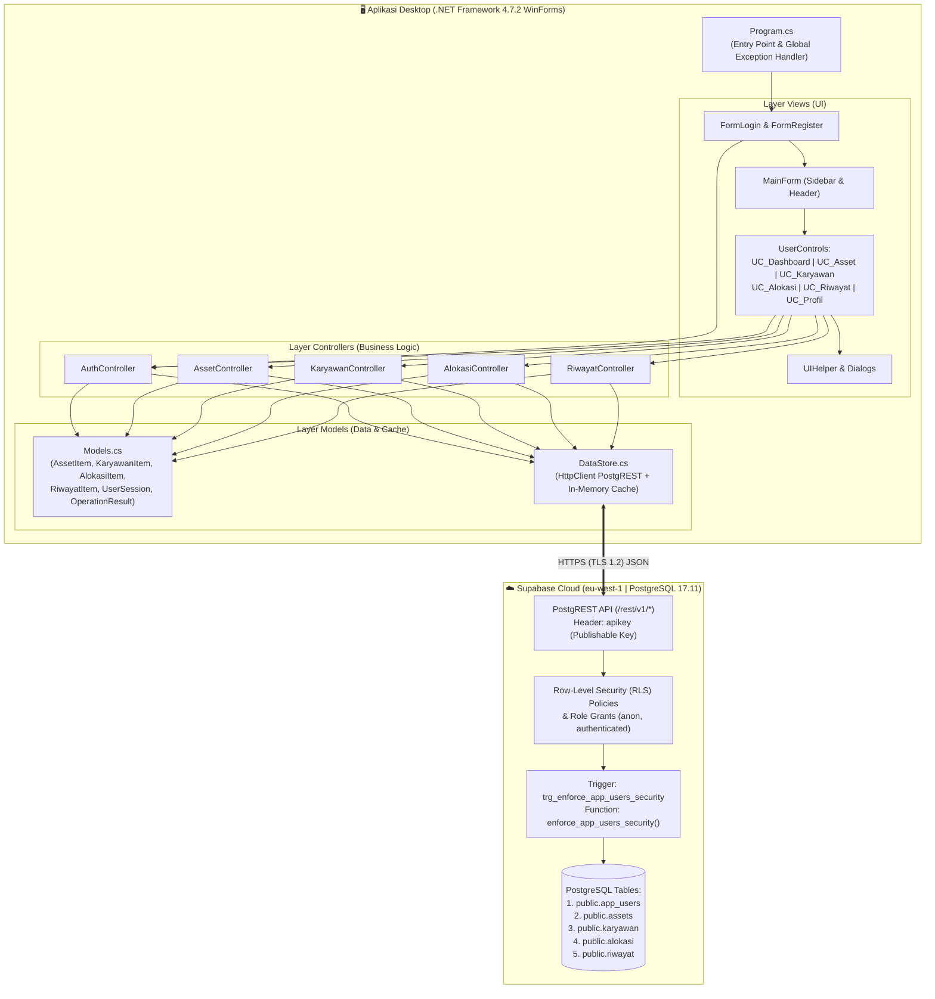

# 🏛️ IT Asset Management (ITAM) — Master Knowledge Base & Wiki

> [!info] Selamat Datang di Vault Dokumentasi Resmi **IT Asset Management**
> Dokumentasi ini dirancang menggunakan struktur **Obsidian Knowledge Graph** yang dipadukan dengan kerangka kerja **Diátaxis** (*Tutorials, How-to Guides, Reference, Explanation*) serta **Architecture Decision Records (ADR)**. Buka folder `ITAM-documentation` sebagai *Vault* di **Obsidian** dan tekan `Ctrl + G` untuk melihat visualisasi graf keterkaitan antar modul, tabel database, controller, model, dan tampilan UI secara *real-time*.

---

## 🗺️ Peta Navigasi Utama (*Maps of Content / MOC*)

Gunakan node MOC di bawah ini sebagai pusat eksplorasi (*Hub*) pada Graph View Obsidian:

1. 🏗️ **[[MOC - Arsitektur & Desain]]** — Arsitektur MVC WinForms, siklus hidup aplikasi, konfigurasi, pola desain, dan daftar lengkap ADR.
2. 🗄️ **[[MOC - Database Supabase]]** — Analisis mendalam (*super-deep analysis*) hasil inspeksi langsung *live database* PostgreSQL 17 di Supabase (`agbmfszugvjwvinxfgiy`), mencakup skema, tipe data presisi, relasi, kardinalitas, *check constraints*, *Row-Level Security (RLS)*, *trigger*, *index*, dan riwayat migrasi.
3. 📦 **[[MOC - Layer Models]]** — Dokumentasi lapisan data dan persistensi (`Models.cs`, `DataStore.cs`, `UserSession`, `OperationResult`, konstanta domain).
4. ⚙️ **[[MOC - Layer Controllers]]** — Dokumentasi logika bisnis dan validasi (`AuthController`, `AssetController`, `KaryawanController`, `AlokasiController`, `RiwayatController`).
5. 🖥️ **[[MOC - Layer Views & UI]]** — Dokumentasi antarmuka pengguna Windows Forms (`FormLogin`, `FormRegister`, `MainForm`, 6 *UserControl* halaman, `UIHelper`, dan `Dialogs`).
6. 🔄 **[[MOC - Panduan & Alur Bisnis]]** — Panduan penggunaan, alur transaksi peminjaman/pengembalian aset, matriks RBAC (*Admin vs Staff*), dan mekanisme sinkronisasi *cache*.

> [!tip] Cari Fungsi atau File Secara Instan!
> Ingin langsung mengetahui **"Fungsi X ada di file mana, baris berapa, dan dipanggil oleh siapa?"**
> Buka kamus pencarian terpusat: 👉 **[[Indeks Fungsi dan File]]**

---

## 🧭 Navigasi Berdasarkan Kerangka Diátaxis

| Kuadran Diátaxis | Tujuan Dokumentasi | Catatan Utama di Vault Ini |
| :--- | :--- | :--- |
| **1. Tutorials** *(Learning-oriented)* | Memandu pengguna/developer baru menjalankan proyek dari awal hingga berhasil login. | - [[Panduan Instalasi & Menjalankan Aplikasi]] - [[Alur Autentikasi, Registrasi, dan Sesi]] |
| **2. How-to Guides** *(Problem-oriented)* | Langkah praktis menyelesaikan alur kerja bisnis dan operasional sistem. | - [[Alur Peminjaman (Alokasi) & Pengembalian Aset]] - [[Matriks Hak Akses (RBAC Admin vs Staff)]] - [[Alur Sinkronisasi Cache & Denormalisasi Data]] |
| **3. Reference** *(Information-oriented)* | Kamus teknis super detail: setiap file, kelas, method, parameter, baris kode, dan tabel database. | - [[Indeks Fungsi dan File]] - [[Skema Database & ERD Lengkap]] - [[Models.cs (Entitas & Konstanta Domain)]] - [[DataStore.cs (REST Client & In-Memory Cache)]] - Seluruh catatan di folder `03`, `04`, `05`, `06` |
| **4. Explanation** *(Understanding-oriented)* | Menjelaskan *mengapa* sistem dirancang demikian (*trade-offs*, keamanan, arsitektur, dan ADR). | - [[Arsitektur MVC & Alur Data]] - [[Keamanan RLS, Trigger, dan Fungsi Database]] - [[Riwayat Migrasi & Audit Best Practices]] - Seluruh catatan di folder `08 - ADR` |

---

## 📊 Ringkasan Eksekutif Aplikasi

**IT Asset Management (ITAM)** adalah aplikasi desktop berbasis **C# .NET Framework 4.7.2 (Windows Forms)** yang terintegrasi secara *cloud-native* dengan backend **Supabase (PostgreSQL 17.11 + PostgREST API)**. Aplikasi ini digunakan untuk mengelola siklus hidup inventaris perangkat IT perusahaan:

- **Inventarisasi Master Aset IT Multi-Unit** (`AST-001`, dst.) beserta rincian kuota unit dinamis (`Jumlah`, `Tersedia`, `Perbaikan`, `Rusak`), pengelolaan kondisi parsial di gudang (`UC_Asset`), pemantauan label kondisi campuran (`Baik (x), Perbaikan (y), Rusak (z)`), dan status ketersediaan (`Tersedia`, `Dipinjam`).
- **Manajemen Master Karyawan** (`EMP-001`, dst.) sebagai penerima hak pinjam perangkat kerja lintas divisi (`Software Dev`, `UI/UX Design`, `IT Support`, `Finance`, `HRD`, `Marketing`).
- **Sirkulasi Peminjaman / Alokasi & Pengembalian Aset Multi-Unit** (`ALK-001`, dst.) yang dapat diakses oleh **Admin IT maupun Staff IT**: aset berjumlah banyak masih bisa dipinjam selama unit `Tersedia >= 1`, mendukung peminjaman multi-unit serta pengembalian berkondisi campuran (*sebagian Perbaikan/Rusak, sisanya Baik*), dan hanya terkunci (`Status = 'Dipinjam'`) ketika `Tersedia == 0` saat seluruh unit sedang dipinjam.
- **Visual Empty State Kontekstual & Pewarnaan Kondisi-Sadar** untuk memastikan tabel kosong menampilkan informasi jelas dan baris `Pengembalian Rusak/Perbaikan` serta `Hapus Aset` memiliki pembedaan warna akurat.
- **Audit Trail / Riwayat Aktivitas** otomatis untuk setiap `Tambah Aset`, `Peminjaman`, `Pengembalian`, dan `Hapus Aset` beserta pencatatan waktu (`timestamptz`), jumlah unit, catatan, dan nama tampilan pelaku (`oleh_user`).
- **Kontrol Akses Berbasis Peran (RBAC)** antara **Admin IT** (akses penuh master aset, master karyawan, alokasi, riwayat & pembersihan log, serta profil) dan **Staff IT** (akses Dashboard, transaksi peminjaman & pengembalian di `Alokasi Aset`, pembacaan & filter `Riwayat Aktivitas`, serta ubah `Profil Akun`) yang diperkuat oleh *database trigger* anti-*privilege escalation*.

---

## 🌐 Diagram Topologi Sistem Tingkat Tinggi

---

## 🗂️ Daftar Lengkap Seluruh Catatan di Vault Ini

### 01 - Maps of Content (MOCs)
- [[MOC - Arsitektur & Desain]]
- [[MOC - Database Supabase]]
- [[MOC - Layer Models]]
- [[MOC - Layer Controllers]]
- [[MOC - Layer Views & UI]]
- [[MOC - Panduan & Alur Bisnis]]

### 02 - Arsitektur & Konfigurasi
- [[Arsitektur MVC & Alur Data]]
- [[Program.cs & Siklus Hidup Aplikasi]]
- [[App.config & Proyek (.csproj)]]
- [[Indeks Fungsi dan File]]

### 03 - Database Supabase
- [[Skema Database & ERD Lengkap]]
- [[Tabel app_users]]
- [[Tabel assets]]
- [[Tabel karyawan]]
- [[Tabel alokasi]]
- [[Tabel riwayat]]
- [[Keamanan RLS, Trigger, dan Fungsi Database]]
- [[Riwayat Migrasi & Audit Best Practices]]

### 04 - Models
- [[Models.cs (Entitas & Konstanta Domain)]]
- [[DataStore.cs (REST Client & In-Memory Cache)]]
- [[UserSession & OperationResult]]

### 05 - Controllers
- [[AuthController]]
- [[AssetController]]
- [[KaryawanController]]
- [[AlokasiController]]
- [[RiwayatController]]

### 06 - Views & UI
- [[MainForm (Navigasi & RBAC UI)]]
- [[FormLogin & FormRegister]]
- [[UC_Dashboard]]
- [[UC_Asset]]
- [[UC_Karyawan]]
- [[UC_Alokasi]]
- [[UC_Riwayat]]
- [[UC_Profil]]
- [[UIHelper & Dialogs]]

### 07 - Alur Bisnis & Panduan
- [[Panduan Instalasi & Menjalankan Aplikasi]]
- [[Alur Autentikasi, Registrasi, dan Sesi]]
- [[Alur Peminjaman (Alokasi) & Pengembalian Aset]]
- [[Alur Sinkronisasi Cache & Denormalisasi Data]]
- [[Matriks Hak Akses (RBAC Admin vs Staff)]]

### 08 - ADR (Architecture Decision Records)
- [[ADR-001 - Komunikasi Langsung Supabase PostgREST Tanpa SDK Eksternal]]
- [[ADR-002 - Strategi In-Memory Caching pada DataStore]]
- [[ADR-003 - Penggunaan Natural Primary Key dan Denormalisasi Terkendali pada Tabel Alokasi]]
- [[ADR-004 - Arsitektur Autentikasi Kustom SHA-256 dan Proteksi Trigger Privilege Escalation]]
- [[ADR-005 - Penanganan Error Global Ramah Pengguna dan Debounce Pencarian UI]]
- [[ADR-006 - Manajemen Stok Aset Multi-Unit, Empty State UI, dan Unit Testing]]
- [[ADR-007 - Relasi Riwayat ke Pengguna dan Kontak Karyawan Unik]]
