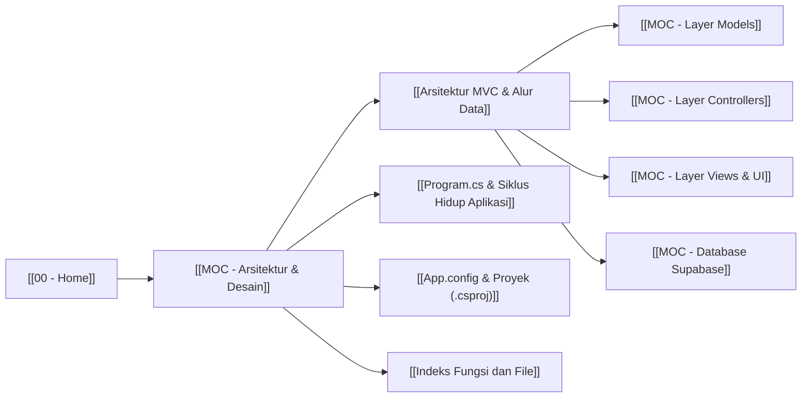

# 🏗️ MOC - Arsitektur & Desain

⬅️ Kembali ke [[00 - Home]]

> [!info] Tentang Peta Konten Ini
> **MOC - Arsitektur & Desain** menghubungkan seluruh dokumentasi struktural aplikasi **IT Asset Management**, mulai dari pola arsitektur **Model-View-Controller (MVC)** pada Windows Forms, konfigurasi proyek `.NET Framework 4.7.2`, kamus indeks seluruh kode sumber, hingga catatan keputusan arsitektur (**ADR**).

---

## 📐 Fondasi Arsitektur & Konfigurasi Sistem

1. **[[Arsitektur MVC & Alur Data]]**
   Penjelasan mendalam mengenai pemisahan tanggung jawab (*Separation of Concerns*) antara `Views`, `Controllers`, dan `Models`, serta bagaimana request mengalir dari interaksi pengguna hingga ke Supabase PostgREST API.
2. **[[Program.cs & Siklus Hidup Aplikasi]]**
   Titik masuk utama (`Main()`), mekanisme *Global Exception Handling* (`ThreadException` & `UnhandledException`), dan siklus hidup pergantian antar jendela (`FormLogin` ↔ `MainForm`).
3. **[[App.config & Proyek (.csproj)]]**
   Bedah konfigurasi proyek Visual Studio (`ITAssetManagement.csproj`), target framework `v4.7.2`, dependensi assembly bawaan .NET, dan penyimpanan kredensial koneksi Supabase (`SupabaseUrl` & `SupabaseKey`).
4. **[[Indeks Fungsi dan File]]**
   Kamus referensi terpusat yang memetakan **setiap file, kelas, properti, dan fungsi/method** di seluruh aplikasi lengkap dengan lokasi baris kode dan pemanggilnya.

---

## 📜 Architecture Decision Records (ADR)

Keputusan teknis utama yang diambil dalam rancang bangun aplikasi ini didokumentasikan mengikuti standar ADR:

- **[[ADR-001 - Komunikasi Langsung Supabase PostgREST Tanpa SDK Eksternal]]**
  Mengapa aplikasi menggunakan `HttpClient` dan `JavaScriptSerializer` bawaan `.NET Framework 4.7.2` alih-alih NuGet `supabase-csharp` atau `Newtonsoft.Json`.
- **[[ADR-002 - Strategi In-Memory Caching pada DataStore]]**
  Mengapa *write-through / local-sync caching* di `DataStore` dipilih untuk mempercepat navigasi antar tab UI dan pencarian instan tanpa membebani jaringan.
- **[[ADR-003 - Penggunaan Natural Primary Key dan Denormalisasi Terkendali pada Tabel Alokasi]]**
  Mengapa `kode_aset`, `nik`, `id_alokasi`, dan `username` dijadikan Primary Key serta bagaimana sinkronisasi kolom denormalisasi (`nama_aset`, `nama_karyawan`, `divisi`) dijaga tetap konsisten.
- **[[ADR-004 - Arsitektur Autentikasi Kustom SHA-256 dan Proteksi Trigger Privilege Escalation]]**
  Bagaimana autentikasi aplikasi desktop diamankan menggunakan *check constraint* regex SHA-256, RLS terpisah per operasi, dan *trigger* `enforce_app_users_security()`.
- **[[ADR-005 - Penanganan Error Global Ramah Pengguna dan Debounce Pencarian UI]]**
  Mengapa pesan kesalahan teknis disembunyikan melalui *Global Exception Handler* dan bagaimana timer *debounce* 300ms mencegah *lag* pada `DataGridView`.
- **[[ADR-006 - Manajemen Stok Aset Multi-Unit, Empty State UI, dan Unit Testing]]**
  Bagaimana aplikasi mendukung stok aset lebih dari 1 unit (`Jumlah`, `Tersedia`, `Perbaikan`, `Rusak`), pengelolaan kondisi parsial di gudang, log `Hapus Aset`, serta pewarnaan baris kondisi-sadar beserta *Empty State* UI.
- **[[ADR-007 - Relasi Riwayat ke Pengguna dan Kontak Karyawan Unik]]**
  Keputusan menghubungkan `riwayat.username_pelaku` ke Primary Key `app_users.username` (agar semua tabel berelasi tanpa membuat `nama_lengkap` unik), penjagaan keunikan kontak telepon/email karyawan di aplikasi dan trigger database, serta proyek unit test NUnit terpisah (`ITAssetManagement.Tests`).

---

## 🔗 Keterkaitan Lintas Layer

