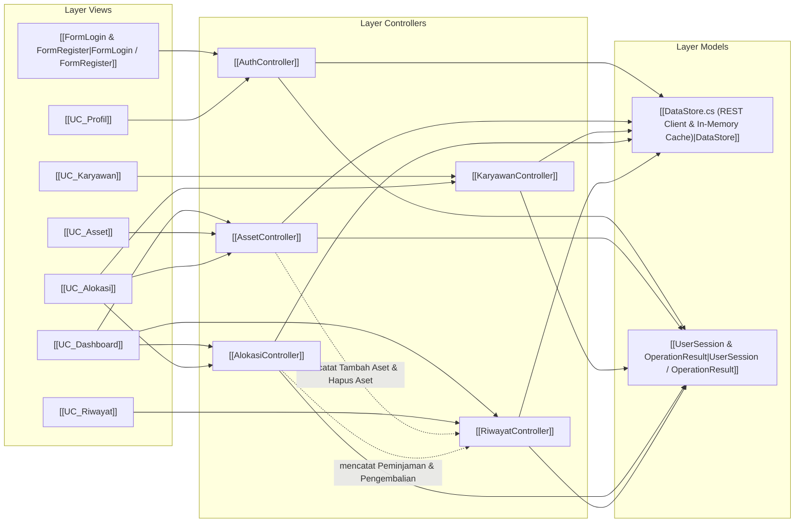

# ⚙️ MOC - Layer Controllers

⬅️ Kembali ke [[00 - Home]] | Lihat juga: [[MOC - Layer Models]] · [[MOC - Layer Views & UI]] · [[MOC - Panduan & Alur Bisnis]]

> [!info] Tentang Peta Konten Ini
> **MOC - Layer Controllers** memetakan seluruh kelas logika bisnis di dalam namespace `ITAssetManagement.Controllers` (folder `Controllers/`). Setiap Controller bertindak sebagai penghubung antara tampilan (`Views`) dan penyimpanan data (`DataStore`), melakukan validasi input, menjaga konsistensi cache memori dan database Supabase, serta mengembalikan objek [[UserSession & OperationResult|OperationResult]].

---

## 🗂️ Daftar Controller dalam Sistem

1. 🔐 **[[AuthController]]** (`Controllers/AuthController.cs`)
   Mengelola autentikasi pengguna (`Login`), pendaftaran akun baru (`Register`), pembaruan profil username/password (`UpdateProfile`), validasi format username (`ValidateUsername`), serta *hashing* SHA-256 (`HashPassword`).
2. 💻 **[[AssetController]]** (`Controllers/AssetController.cs`)
   Mengelola data master aset IT: pencarian/penyaringan kode, nama, kategori, kondisi, status, maupun pinjaman parsial (`GetAll`), filter aset siap pinjam (`GetReadyToLend`), penomoran kode otomatis `AST-xxx` (`NextCode`), resolusi kondisi stok parsial (`ResolveStokKondisi`), penambahan & pembaruan aset beserta rincian unit `Baik`/`Perbaikan`/`Rusak` (`Add`, `Update`), serta penghapusan aset berproteksi ganda yang mencatat log `Hapus Aset` (`Delete`).
3. 🧑‍💼 **[[KaryawanController]]** (`Controllers/KaryawanController.cs`)
   Mengelola data master karyawan: pencarian (`GetAll`), penomoran otomatis `EMP-xxx` (`NextNik`), penambahan karyawan dengan nilai default aman (`Add`), pembaruan data karyawan beserta sinkronisasi nama & divisi ke tabel alokasi (`Update`), dan penghapusan karyawan yang tidak memiliki pinjaman aktif (`Delete`).
4. 🤝 **[[AlokasiController]]** (`Controllers/AlokasiController.cs`)
   Mengelola transaksi sirkulasi aset multi-unit: daftar pinjaman aktif (`GetActive`), peminjaman/alokasi sejumlah unit ke karyawan dengan kode `ALK-xxx` (`Allocate`), dan pengembalian aset penuh maupun berkondisi campuran (`Return`).
5. 📜 **[[RiwayatController]]** (`Controllers/RiwayatController.cs`)
   Mengelola log audit aktivitas: pencatatan log otomatis *non-blocking* (`Add`), penyaringan berdasarkan jenis aksi dan kata kunci termasuk kolom `JenisAksi` (`Search`), pengambilan $N$ riwayat terbaru untuk Dashboard (`Latest`), dan pembersihan seluruh riwayat khusus Admin (`ClearAll`).

---

## 🔄 Peta Dependensi Antar Controller, View, dan Model

