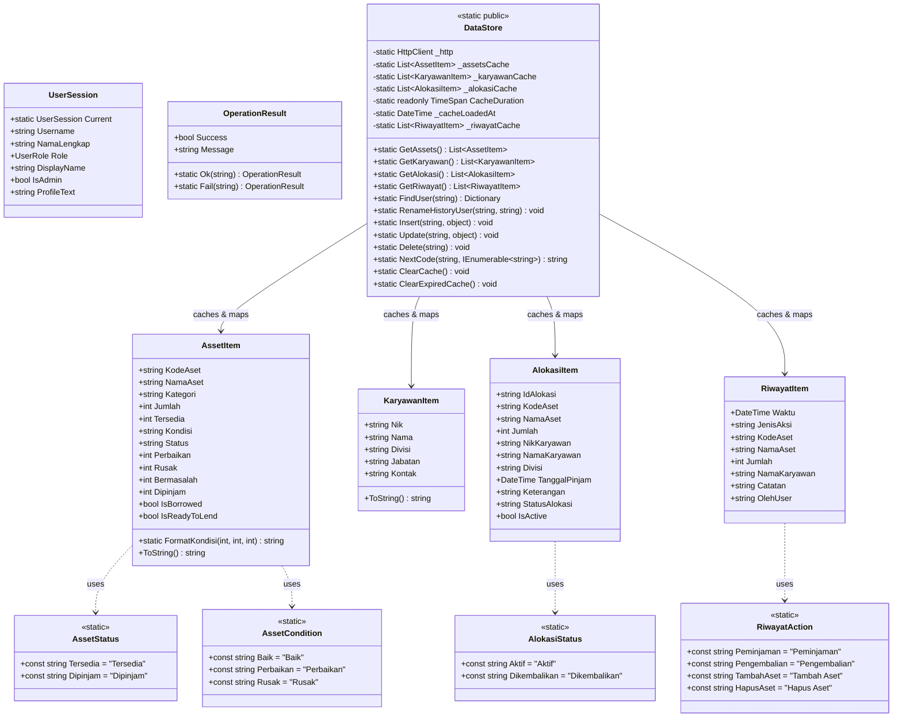

# 📦 MOC - Layer Models

⬅️ Kembali ke [[00 - Home]] | Lihat juga: [[MOC - Arsitektur & Desain]] · [[MOC - Database Supabase]] · [[MOC - Layer Controllers]]

> [!info] Tentang Peta Konten Ini
> **MOC - Layer Models** mencakup seluruh kelas yang berada di namespace `ITAssetManagement.Models` (folder `Models/`). Layer ini bertugas merepresentasikan struktur data domain bisnis, konstanta status/kondisi, status sesi pengguna aktif, pembungkus hasil operasi (*result pattern*), serta jembatan komunikasi HTTP ke Supabase beserta *in-memory cache*.

---

## 📄 Daftar Dokumentasi di Layer Models

1. **[[Models.cs (Entitas & Konstanta Domain)]]**
   Dokumentasi lengkap untuk:
   - Kelas konstanta statis: `AssetStatus`, `AssetCondition`, `AlokasiStatus`, `RiwayatAction` (termasuk `HapusAset`).
   - Kelas model entitas: `AssetItem` (dengan stok multi-unit `Jumlah`, `Tersedia`, `Perbaikan`, `Rusak`, properti terhitung `Bermasalah`, `Dipinjam`, `IsBorrowed`, `IsReadyToLend`, serta `FormatKondisi()`), `KaryawanItem`, `AlokasiItem` (dengan `Jumlah` & `IsActive`), dan `RiwayatItem` (dengan `Jumlah`).
   - Penggunaan atribut `[Browsable(false)]` dan *override* `ToString()` untuk integrasi langsung dengan komponen WinForms (`DataGridView` dan `ComboBox`).
2. **[[DataStore.cs (REST Client & In-Memory Cache)]]**
   Dokumentasi lengkap mesin komunikasi HTTP ke Supabase (`/rest/v1/*`):
   - Konfigurasi `HttpClient` tunggal (*singleton-like static initialization*), TLS 1.2, header `apikey`, dan `Prefer: return=minimal`.
   - Empat koleksi cache memori statis (`_assetsCache`, `_karyawanCache`, `_alokasiCache`, `_riwayatCache`) dengan masa berlaku TTL 60 detik (`ClearExpiredCache()`).
   - Generator kode otomatis `NextCode()` (`AST-xxx`, `EMP-xxx`, `ALK-xxx`), `RenameHistoryUser()`, dan *network error throttling* (`_lastErrorTime` 3 detik).
3. **[[UserSession & OperationResult]]**
   Dokumentasi untuk:
   - Enum `UserRole` (`Admin`, `Staff`).
   - Kelas sesi aktif `UserSession` (`UserSession.Current`, `Username`, `NamaLengkap`, `DisplayName`, `IsAdmin`, `ProfileText`).
   - Kelas pola hasil eksekusi `OperationResult` (`Success`, `Message`, `Ok()`, `Fail()`).

---

## 🧩 Diagram Kelas Layer Models

