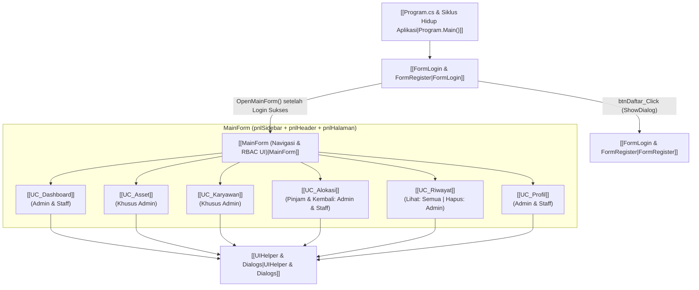

# 🖥️ MOC - Layer Views & UI

⬅️ Kembali ke [[00 - Home]] | Lihat juga: [[MOC - Layer Controllers]] · [[MOC - Panduan & Alur Bisnis]]

> [!info] Tentang Peta Konten Ini
> **MOC - Layer Views & UI** menghimpun seluruh dokumentasi komponen antarmuka pengguna (**Windows Forms**) di dalam namespace `ITAssetManagement.Views` (folder `Views/`). Layer ini mencakup 3 `Form` utama, 6 halaman `UserControl` yang dimuat secara dinamis di dalam `MainForm`, serta 2 kelas utilitas tampilan (`UIHelper` dan `Dialogs`).

---

## 🪟 Daftar Form & Halaman UserControl

### 1. Jendela Utama (`Form`)
- 🔑 **[[FormLogin & FormRegister]]** (`Views/FormLogin.cs` & `Views/FormRegister.cs`)
  Jendela autentikasi awal saat aplikasi dijalankan dan dialog modal pendaftaran akun pengguna baru.
- 🧭 **[[MainForm (Navigasi & RBAC UI)]]** (`Views/MainForm.cs`)
  Kerangka utama aplikasi (*shell*) yang memuat panel navigasi sidebar kiri (`pnlSidebar`), header informasi pengguna aktif (`pnlHeader`), tombol Logout, penyusunan menu dinamis berdasarkan role (`ArrangeMenus`), dan kontainer halaman (`pnlHalaman`).

### 2. Halaman Konten Dinamis (`UserControl`)
- 📊 **[[UC_Dashboard]]** (`Views/UC_Dashboard.cs`)
  Menampilkan 4 kartu indikator kinerja utama (*Total Aset*, *Aset Tersedia*, *Sedang Dipinjam*, *Rusak / Perbaikan*), tabel pinjaman aktif, dan 10 riwayat aktivitas terakhir.
- 💻 **[[UC_Asset]]** (`Views/UC_Asset.cs`)
  Halaman khusus **Admin** untuk menambah, mengubah (termasuk pengaturan kondisi sebagian unit `Baik` / `Perbaikan` / `Rusak` via `NumericUpDown` & pilihan kondisi cepat), menghapus (dengan validasi pinjaman aktif & pencatatan log `Hapus Aset`), mereset form, dan mencari data master aset IT secara *real-time* (dengan *debounce* 300ms).
- 🧑‍💼 **[[UC_Karyawan]]** (`Views/UC_Karyawan.cs`)
  Halaman khusus **Admin** untuk mengelola data master karyawan penerima aset lintas divisi.
- 🤝 **[[UC_Alokasi]]** (`Views/UC_Alokasi.cs`)
  Halaman sirkulasi aset untuk **Admin** dan **Staff** yang menyediakan panel **Form Peminjaman** (mendukung peminjaman multi-unit `Jumlah <= Tersedia`) dan panel **Pengembalian Aset** (mendukung pencatatan kondisi per unit yang dikembalikan: `Baik`, `Perbaikan`, atau `Rusak`).
- 📜 **[[UC_Riwayat]]** (`Views/UC_Riwayat.cs`)
  Halaman log aktivitas keluar-masuk dan mutasi master aset dengan filter jenis aksi (`Semua`, `Peminjaman`, `Pengembalian`, `Tambah Aset`, `Hapus Aset`), pencarian kata kunci (termasuk jenis aksi), legenda 6 badge indikator warna dinamis (`flpLegenda`), tampilan catatan *word-wrap*, dan tombol **Bersihkan Riwayat** khusus **Admin**.
- 👤 **[[UC_Profil]]** (`Views/UC_Profil.cs`)
  Halaman pengaturan akun untuk melihat username/role aktif serta memperbarui username dan/atau password dengan verifikasi password lama.

### 3. Utilitas & Komponen Pembantu UI
- 🎨 **[[UIHelper & Dialogs]]** (`Views/UIHelper.cs` & `Views/Dialogs.cs`)
  Pusat pengaturan tampilan tabel `DataGridView` (`BindGrid`, `FormatHeader`, `ColorizeRows`, `ApplyRowColors`, `ClearSelection`) dengan pewarnaan baris sensitif kondisi untuk aset & riwayat plus warna seleksi yang kontras, indikator badge *loading* mengambang (`ShowLoading` / `HideLoading`), timer penunda ketikan pencarian (`Debounce` / `CancelDebounce`), serta pembungkus `MessageBox` standar (`Info`, `Warn`, `Error`, `Confirm`, `Show`).

---

## 🌳 Hirarki Komponen UI Windows Forms

