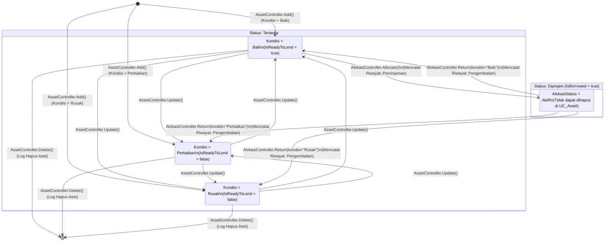

# 🔄 MOC - Panduan & Alur Bisnis

⬅️ Kembali ke [[00 - Home]] | Lihat juga: [[MOC - Layer Controllers]] · [[MOC - Layer Views & UI]] · [[MOC - Database Supabase]]

> [!info] Tentang Peta Konten Ini
> **MOC - Panduan & Alur Bisnis** menyatukan kuadran **Tutorials** dan **How-to Guides** dari kerangka kerja **Diátaxis**, lengkap dengan diagram urutan (*Sequence Diagram*) dan diagram status (*State Machine*) yang menjelaskan cara kerja bisnis aplikasi dari ujung ke ujung (*end-to-end*).

---

## 📚 Daftar Panduan & Alur Kerja Sistem

1. 🚀 **[[Panduan Instalasi & Menjalankan Aplikasi]]** *(Diátaxis: Tutorial)*
   Langkah demi langkah menyiapkan lingkungan kerja Visual Studio (.NET Framework 4.7.2), memeriksa konfigurasi `App.config`, mem-build proyek (`MSBuild`), hingga menjalankan aplikasi dan login pertama kali.
2. 🔐 **[[Alur Autentikasi, Registrasi, dan Sesi]]** *(Diátaxis: Explanation & How-to)*
   Penjelasan alur *hashing* SHA-256, proses login ke tabel `app_users`, registrasi akun baru beserta peran otomatis dari trigger PostgreSQL `enforce_app_users_security()`, pembaruan username yang otomatis me-rename log `riwayat.oleh_user`, hingga pembersihan cache saat Logout.
3. 🤝 **[[Alur Peminjaman (Alokasi) & Pengembalian Aset]]** *(Diátaxis: How-to & Workflow)*
   Siklus hidup stok dinamis aset (`Tersedia`, `Dipinjam`, `Perbaikan`, `Rusak`), syarat kelayakan pinjam multi-unit (`IsReadyToLend` & `Tersedia > 0`), transaksi multi-tabel saat peminjaman/pengembalian oleh **Admin** dan **Staff**, pengelolaan kondisi parsial gudang oleh **Admin**, serta pencatatan log riwayat otomatis termasuk `Tambah Aset` dan `Hapus Aset`.
4. ⚡ **[[Alur Sinkronisasi Cache & Denormalisasi Data]]** *(Diátaxis: Explanation)*
   Bagaimana aplikasi menjaga konsistensi antara database Supabase dan 4 list cache memori di `DataStore`, termasuk propagasi perubahan nama aset (`AssetController.Update`), perubahan nama/divisi karyawan (`KaryawanController.Update`), dan perubahan username (`AuthController.UpdateProfile`).
5. 🛡️ **[[Matriks Hak Akses (RBAC Admin vs Staff)]]** *(Diátaxis: Reference & Security)*
   Tabel perbandingan lengkap hak akses antara **Admin IT** dan **Staff IT** baik pada level tampilan UI (`MainForm`, `UC_Alokasi`, `UC_Riwayat`), level Controller, maupun level Database Trigger & RLS.

---

## 🔄 Siklus Hidup Status & Kondisi Aset (State Machine)

> [!NOTE] Stok Multi-Unit & Kondisi Parsial
> Untuk aset dengan `Jumlah > 1`, sebagian unit dapat berstatus `Tersedia`, `Dipinjam`, `Perbaikan`, maupun `Rusak` secara bersamaan (`Tersedia = max(0, Jumlah - Dipinjam - Perbaikan - Rusak)`). Admin juga dapat menyesuaikan jumlah unit `Perbaikan` dan `Rusak` di gudang melalui `UC_Asset` → `AssetController.Update()`. Penghapusan aset (`AssetController.Delete()`) diblokir apabila masih ada unit dengan status `Dipinjam` (`IsBorrowed`).
