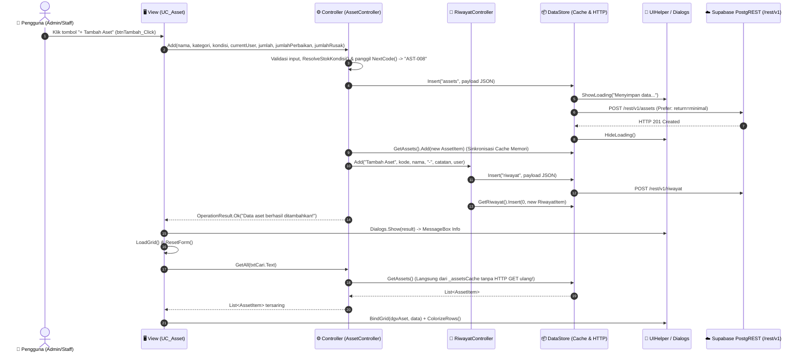

# 🏛️ Arsitektur MVC & Alur Data

⬅️ Kembali ke [[MOC - Arsitektur & Desain]] | [[00 - Home]]

> [!info] Ringkasan Arsitektur
> Aplikasi **IT Asset Management** mengadopsi pola arsitektur **Model-View-Controller (MVC)** yang diadaptasi secara bersih dan pragmatis untuk aplikasi desktop **Windows Forms (.NET Framework 4.7.2)** dengan penyimpanan *cloud* terpusat pada **Supabase PostgREST API**.

---

## 1. Struktur Folder dan Pemisahan Layer (*Separation of Concerns*)

Kode sumber proyek diorganisasikan ke dalam 3 namespace utama di bawah root namespace `ITAssetManagement`:

| Layer / Folder | Namespace | Tanggung Jawab Utama | File di Dalamnya |
| :--- | :--- | :--- | :--- |
| **Root / Entry** | `ITAssetManagement` | Titik masuk aplikasi (`Main`), *Global Exception Handling*, dan konfigurasi koneksi. | - [[Program.cs & Siklus Hidup Aplikasi\|Program.cs]] - [[App.config & Proyek (.csproj)\|App.config]] - [[App.config & Proyek (.csproj)\|ITAssetManagement.csproj]] |
| **Models** (`Models/`) | `ITAssetManagement.Models` | Representasi objek domain (entitas), konstanta bisnis, manajemen sesi pengguna (`UserSession`), pembungkus status operasi (`OperationResult`), klien HTTP REST Supabase, dan *in-memory caching* (`DataStore`). | - [[Models.cs (Entitas & Konstanta Domain)\|Models.cs]] - [[DataStore.cs (REST Client & In-Memory Cache)\|DataStore.cs]] |
| **Controllers** (`Controllers/`) | `ITAssetManagement.Controllers` | Logika bisnis, validasi input, aturan domain (seperti larangan menghapus aset yang sedang dipinjam), orkestrasi pemanggilan `DataStore`, sinkronisasi data denormalisasi, dan pencatatan riwayat otomatis. | - [[AuthController]] - [[AssetController]] - [[KaryawanController]] - [[AlokasiController]] - [[RiwayatController]] |
| **Views** (`Views/`) | `ITAssetManagement.Views` | Antarmuka pengguna Windows Forms (`Form` dan `UserControl`), penangkapan *event* klik/ketik pengguna, pemformatan tabel `DataGridView`, pewarnaan baris, *debounce* pencarian, dan kotak dialog pesan. | - [[FormLogin & FormRegister\|FormLogin.cs / FormRegister.cs]] - [[MainForm (Navigasi & RBAC UI)\|MainForm.cs]] - [[UC_Dashboard]], [[UC_Asset]], [[UC_Karyawan]], [[UC_Alokasi]], [[UC_Riwayat]], [[UC_Profil]] - [[UIHelper & Dialogs\|UIHelper.cs / Dialogs.cs]] |

---

## 2. Diagram Alur Data (*End-to-End Request Lifecycle*)

Diagram berikut memperlihatkan bagaimana sebuah aksi pengguna (misalnya mengklik tombol **+ Tambah Aset** pada [[UC_Asset]]) mengalir melewati setiap lapisan arsitektur hingga tersimpan di Supabase dan memperbarui tampilan tabel:

---

## 3. Prinsip Desain Utama yang Diterapkan

### A. *Zero External NuGet Dependencies* (Kemandirian Penuh pada .NET Framework 4.7.2)
Aplikasi ini tidak bergantung pada paket NuGet pihak ketiga yang rawan konflik versi binding redirect. Seluruh komunikasi HTTP menggunakan `System.Net.Http.HttpClient` dan serialisasi JSON menggunakan `System.Web.Script.Serialization.JavaScriptSerializer` bawaan assembly `System.Web.Extensions`.
👉 Lihat detail keputusannya di: [[ADR-001 - Komunikasi Langsung Supabase PostgREST Tanpa SDK Eksternal]].

### B. *Write-Through / In-Memory Cache Sync*
Saat pertama kali pengguna membuka halaman (misalnya [[UC_Dashboard]]), [[DataStore.cs (REST Client & In-Memory Cache)|DataStore]] mengambil data dari Supabase melalui `GET /rest/v1/...` dan menyimpannya ke dalam list statis (`_assetsCache`, `_karyawanCache`, `_alokasiCache`, `_riwayatCache`).
- Ketika pengguna mengetik di kotak pencarian, mengganti filter, atau berpindah antar tab menu melalui `MainForm.ShowPage()` selama cache masih berlaku (`< 60 detik`), aplikasi membaca langsung dari *cache* memori dalam waktu `< 1 ms` tanpa membebani jaringan. `MainForm.ShowPage()` memanggil `DataStore.ClearExpiredCache()` sehingga cache baru dibersihkan dan dimuat ulang dari Supabase apabila umurnya telah mencapai 60 detik.
- Setiap operasi tulis (`Insert`, `Update`, `Delete`) terlebih dahulu mengirim request ke Supabase. Hanya jika server mengembalikan status HTTP sukses (`2xx`), Controller memperbarui *cache* memori lokal secara sinkron.
- Ketika pengguna melakukan **Logout**, `DataStore.ClearCache()` dipanggil sehingga sesi berikutnya selalu mengambil data segar dari server.
👉 Lihat detail keputusannya di: [[ADR-002 - Strategi In-Memory Caching pada DataStore]] dan [[Alur Sinkronisasi Cache & Denormalisasi Data]].

### C. *OperationResult Pattern* untuk Komunikasi Controller → View
Controller tidak pernah memunculkan `MessageBox` secara langsung (menjaga *Controller* tetap bebas dari ketergantungan UI). Sebaliknya, setiap method mutasi di Controller mengembalikan objek [[UserSession & OperationResult|OperationResult]] (`OperationResult.Ok(...)` atau `OperationResult.Fail(...)`), yang kemudian ditampilkan oleh View menggunakan `Dialogs.Show(result)`.

### D. *Fail-Safe Logging* pada Riwayat Aktivitas
Di dalam [[RiwayatController]], pemanggilan `DataStore.Insert("riwayat", ...)` dibungkus dalam blok `try-catch` yang mengabaikan kegagalan jaringan sesaat agar transaksi bisnis utama (seperti peminjaman atau pengembalian aset) tidak batal hanya karena pencatatan log mengalami gangguan.

---

## 🔗 Tautan Terkait
- [[Program.cs & Siklus Hidup Aplikasi]]
- [[App.config & Proyek (.csproj)]]
- [[Indeks Fungsi dan File]]
- [[DataStore.cs (REST Client & In-Memory Cache)]]
- [[Skema Database & ERD Lengkap]]
