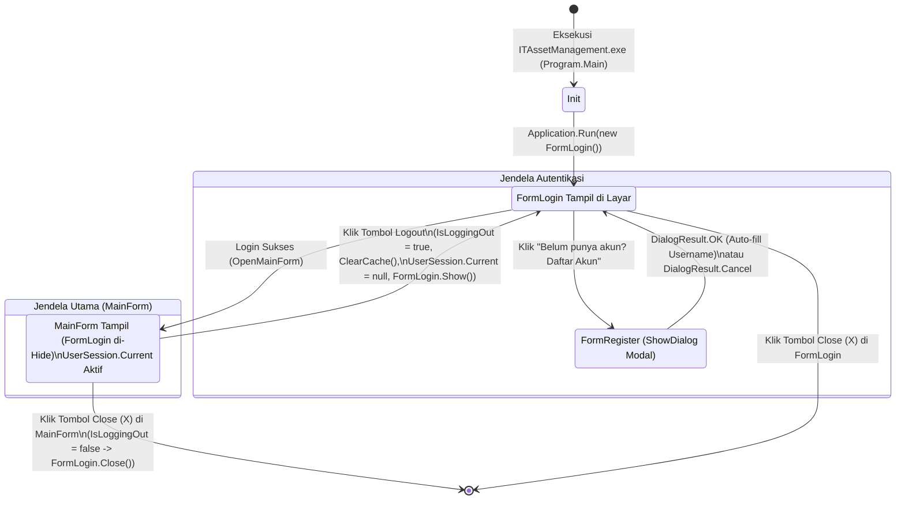

# 🚀 Program.cs & Siklus Hidup Aplikasi

⬅️ Kembali ke [[MOC - Arsitektur & Desain]] | Lihat juga: [[Arsitektur MVC & Alur Data]] · [[FormLogin & FormRegister]] · [[MainForm (Navigasi & RBAC UI)]]

> [!info] Lokasi File Kode Sumber
> - **File**: [Program.cs](file:///d:/AMIKOM/Pemrograman%20Lanjut/Project/ITAssetManagement/ITAssetManagement/Program.cs#L1-L40)
> - **Namespace**: `ITAssetManagement`
> - **Class**: `internal static class Program`

---

## 1. Peran & Tanggung Jawab `Program.cs`

`Program.cs` adalah titik masuk utama (*entry point*) ketika file executable `ITAssetManagement.exe` dijalankan pada sistem operasi Windows. Kelas ini memiliki tiga tanggung jawab krusial:

1. **Inisialisasi Visual WinForms**: Mengaktifkan gaya visual modern Windows (`Application.EnableVisualStyles()`) dan mengatur perenderan teks berbasis GDI+ (`Application.SetCompatibleTextRenderingDefault(false)`).
2. **Penanganan Eksepsi Global (*Global Exception Handling*)**: Menangkap seluruh error tak terduga baik pada *UI Thread* maupun *AppDomain* agar pengguna tidak pernah melihat *stack trace* teknis .NET yang membingungkan atau membocorkan detail internal kode/server.
3. **Menjalankan Jendela Autentikasi Awal**: Memulai *message loop* aplikasi dengan membuka instance [[FormLogin & FormRegister|FormLogin]] (`Application.Run(new FormLogin())`).

---

## 2. Daftar Lengkap Method di `Program.cs`

| Method | Signature | Baris Kode | Deskripsi Teknis |
| :--- | :--- | :--- | :--- |
| `Main` | `[STAThread] static void Main()` | [L13-L24](file:///d:/AMIKOM/Pemrograman%20Lanjut/Project/ITAssetManagement/ITAssetManagement/Program.cs#L13-L24) | Menginisialisasi konfigurasi visual WinForms, mendaftarkan *event handler* `Application.ThreadException` dan `AppDomain.CurrentDomain.UnhandledException`, lalu menjalankan `new FormLogin()`. |
| `Application_ThreadException` | `private static void Application_ThreadException(object sender, ThreadExceptionEventArgs e)` | [L27-L31](file:///d:/AMIKOM/Pemrograman%20Lanjut/Project/ITAssetManagement/ITAssetManagement/Program.cs#L27-L31) | Menangani eksepsi tak tertangkap yang terjadi di *UI Thread* Windows Forms. Memanggil `UIHelper.HideLoading()` agar kursor/badge loading tidak menyangkut, lalu menampilkan peringatan ramah pengguna melalui `Dialogs.Warn(...)`. |
| `CurrentDomain_UnhandledException` | `private static void CurrentDomain_UnhandledException(object sender, UnhandledExceptionEventArgs e)` | [L34-L38](file:///d:/AMIKOM/Pemrograman%20Lanjut/Project/ITAssetManagement/ITAssetManagement/Program.cs#L34-L38) | Menangani eksepsi tak tertangkap pada level sistem/`AppDomain` (di luar *UI Thread*). Memanggil `UIHelper.HideLoading()` dan menampilkan pesan peringatan via `Dialogs.Warn(...)`. |

---

## 3. Diagram Siklus Hidup Jendela Aplikasi (*Application Window Lifecycle*)

Perhatikan bagaimana aplikasi mengelola transisi antara [[FormLogin & FormRegister|FormLogin]], [[FormLogin & FormRegister|FormRegister]], dan [[MainForm (Navigasi & RBAC UI)|MainForm]] tanpa mematikan *message loop* utama saat pengguna melakukan **Logout**:

> [!important] Mengapa `FormLogin` Di-`Hide()` Saat Masuk ke `MainForm`?
> Karena `Application.Run(new FormLogin())` mengikat umur proses aplikasi (`ITAssetManagement.exe`) pada objek `FormLogin`.
> - Saat login berhasil ([FormLogin.cs#L66-L73](file:///d:/AMIKOM/Pemrograman%20Lanjut/Project/ITAssetManagement/ITAssetManagement/Views/FormLogin.cs#L66-L73)), `FormLogin` disembunyikan (`Hide()`) dan mendaftarkan event `mainForm.FormClosed += MainForm_FormClosed`.
> - Jika `MainForm` ditutup karena pengguna menekan tombol **Logout** (`mainForm.IsLoggingOut == true`), `MainForm_FormClosed` ([FormLogin.cs#L76-L90](file:///d:/AMIKOM/Pemrograman%20Lanjut/Project/ITAssetManagement/ITAssetManagement/Views/FormLogin.cs#L76-L90)) akan mengosongkan `UserSession.Current`, membersihkan `txtPassword`, dan memanggil `Show()` kembali pada `FormLogin`.
> - Namun jika pengguna menutup `MainForm` menggunakan tombol silang (`X`) di pojok kanan atas (`mainForm.IsLoggingOut == false`), maka `FormLogin` memanggil `Close()` sehingga seluruh aplikasi berhenti dengan bersih.

---

## 🔗 Tautan Terkait
- [[ADR-005 - Penanganan Error Global Ramah Pengguna dan Debounce Pencarian UI]]
- [[FormLogin & FormRegister]]
- [[MainForm (Navigasi & RBAC UI)]]
- [[UIHelper & Dialogs]]
