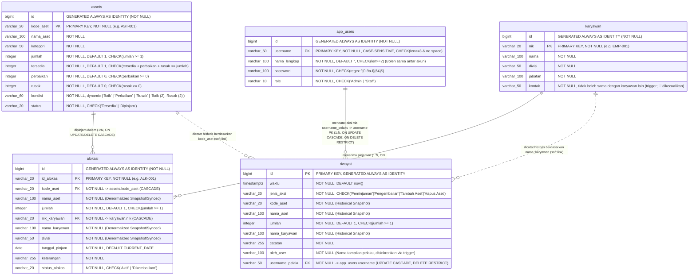

# 🗄️ Skema Database & ERD Lengkap (PostgreSQL 17.11 — Supabase)

⬅️ Kembali ke [[MOC - Database Supabase]] | [[00 - Home]]

> [!info] Metadata Instance Database (Diambil Langsung via Supabase MCP)
> - **Nama Proyek**: `IT Asset Management`
> - **Project ID / Ref**: `agbmfszugvjwvinxfgiy`
> - **Organization ID**: `zvupyddyuwxiqlkgggob`
> - **Region**: `eu-west-1` (West Europe — Ireland)
> - **Database Host**: `db.agbmfszugvjwvinxfgiy.supabase.co`
> - **PostgreSQL Engine Version**: `17.11.0.003` (Release Channel: `ga`)
> - **Status**: `ACTIVE_HEALTHY`
> - **Schema Utama**: `public` (Seluruh 5 tabel mengaktifkan **Row-Level Security / RLS**)
> - **Tabel yang berelasi (FK fisik)**: sejak 2026-11-21 **kelima tabel** terlibat dalam minimal satu Foreign Key (3 FK total, lihat bagian 2A), terbagi dalam dua kelompok relasi: {`assets`, `karyawan`, `alokasi`} dan {`app_users`, `riwayat`}. Sebelumnya hanya 3 tabel yang berelasi. Alasan dan batasan desain: [[ADR-007 - Relasi Riwayat ke Pengguna dan Kontak Karyawan Unik]].

---

## 1. Diagram Entity-Relationship (ERD) Lengkap

Diagram di bawah ini merepresentasikan skema fisik terkini (*live state*) di PostgreSQL 17, mencakup nama kolom, tipe data presisi (`varchar(n)`, `bigint`, `date`, `timestamptz`), kunci utama (`PK`), kunci tamu (`FK`), dan kardinalitas relasi:

---

## 2. Analisis Relasi, Kardinalitas, dan Integritas Referensial

### A. Relasi Fisik (*Hard Foreign Key Constraints*)

| Nama Constraint | Tabel Anak (*Child*) | Kolom FK | Tabel Induk (*Parent*) | Kolom PK | Kardinalitas | Aturan `ON UPDATE` | Aturan `ON DELETE` |
| :--- | :--- | :--- | :--- | :--- | :---: | :---: | :---: |
| `alokasi_kode_aset_fkey` | [[Tabel alokasi\|public.alokasi]] | `kode_aset` | [[Tabel assets\|public.assets]] | `kode_aset` | `N : 1` *(Zero-or-Many)* | `CASCADE` | `CASCADE` |
| `alokasi_nik_karyawan_fkey` | [[Tabel alokasi\|public.alokasi]] | `nik_karyawan` | [[Tabel karyawan\|public.karyawan]] | `nik` | `N : 1` *(Zero-or-Many)* | `CASCADE` | `CASCADE` |
| `riwayat_username_pelaku_fkey` *(baru, 2026-11-21)* | [[Tabel riwayat\|public.riwayat]] | `username_pelaku` | [[Tabel app_users\|public.app_users]] | `username` *(PRIMARY KEY)* | `N : 1` *(Zero-or-Many)* | `CASCADE` | `RESTRICT` |

1. **Relasi `assets` (1) $\longrightarrow$ `alokasi` (0..N)**:
   - Satu jenis barang aset IT (`kode_aset`) dengan kuota stok `jumlah` unit dapat memiliki **nol atau banyak** baris transaksi di tabel `alokasi` sepanjang masa pakainya, dengan maksimal sejumlah **`jumlah` transaksi berstatus `Aktif` secara bersamaan** (dijaga oleh kolom `tersedia`, constraint `CHECK (tersedia >= 0 AND tersedia <= jumlah)`, serta validasi `AssetItem.IsReadyToLend` di [[AlokasiController]]).
   - Karena aturan `ON DELETE CASCADE`, jika sebuah aset yang seluruh unitnya sedang tersedia (`Dipinjam == 0`) dihapus melalui [[AssetController]], seluruh histori baris transaksi di tabel `alokasi` yang merujuk ke `kode_aset` tersebut ikut terhapus secara otomatis oleh PostgreSQL (dan juga dihapus dari cache memori via `DataStore.GetAlokasi().RemoveAll(...)`).
2. **Relasi `karyawan` (1) $\longrightarrow$ `alokasi` (0..N)**:
   - Satu karyawan (`nik`) dapat meminjam **nol, satu, atau banyak** aset IT sekaligus maupun secara historis.
   - [[KaryawanController]] memproteksi agar karyawan yang masih memiliki transaksi `alokasi` berstatus `Aktif` **tidak dapat dihapus**. Jika seluruh pinjamannya sudah `Dikembalikan` dan karyawan dihapus, aturan `ON DELETE CASCADE` akan membersihkan baris `alokasi` lama milik karyawan tersebut.
3. **Relasi `app_users` (1) $\longrightarrow$ `riwayat` (0..N)** *(ditambahkan 2026-11-21)*:
   - Kolom `riwayat.username_pelaku` merujuk langsung ke Primary Key `app_users.username` (`ON UPDATE CASCADE ON DELETE RESTRICT`), sehingga `app_users.nama_lengkap` **tidak perlu `UNIQUE`** (dua pengguna boleh memiliki nama lengkap yang sama).
   - Kolom `riwayat.oleh_user` tetap menyimpan nama tampilan (`nama_lengkap`) agar tampilan tabel di `UC_Riwayat` dan `UC_Dashboard` tidak berubah.
   - Trigger `trg_sync_riwayat_pelaku` pada `public.riwayat` otomatis mengisi `username_pelaku` dari `app_users` saat aplikasi C# mengirim `INSERT` riwayat, dan trigger `trg_sync_app_users_nama_to_riwayat` pada `public.app_users` otomatis memperbarui `riwayat.oleh_user` berdasarkan `username_pelaku` saat pengguna mengubah `nama_lengkap` di [[UC_Profil]].
   - Detail alasan desain: [[ADR-007 - Relasi Riwayat ke Pengguna dan Kontak Karyawan Unik]].

---

### B. Relasi Logis / Historis (*Soft Relationships & Controlled Denormalization*)

Selain Foreign Key fisik di atas, terdapat 3 mekanisme relasi logis/aturan integritas yang dirancang secara sengaja (lihat [[ADR-003 - Penggunaan Natural Primary Key dan Denormalisasi Terkendali pada Tabel Alokasi]] dan [[ADR-007 - Relasi Riwayat ke Pengguna dan Kontak Karyawan Unik]]):

1. **Denormalisasi Terkendali pada `public.alokasi`**:
   - Tabel `alokasi` menyimpan kolom `nama_aset`, `nama_karyawan`, dan `divisi` secara langsung agar query `GET /rest/v1/alokasi` dapat langsung di-bind ke `DataGridView` tanpa memerlukan *nested relational join* PostgREST.
   - Untuk mencegah *stale data*, ketika Admin mengubah `nama_aset` di [[AssetController]] ([L172-L177](file:///d:/AMIKOM/Pemrograman%20Lanjut/Project/ITAssetManagement/ITAssetManagement/Controllers/AssetController.cs#L172-L177)) atau mengubah `nama`/`divisi` di [[KaryawanController]] ([L89-L103](file:///d:/AMIKOM/Pemrograman%20Lanjut/Project/ITAssetManagement/ITAssetManagement/Controllers/KaryawanController.cs#L89-L103)), Controller otomatis mengirim `PATCH /rest/v1/alokasi?...` untuk memperbarui kolom-kolom tersebut di server dan di cache memori!
2. **Snapshot Audit Trail pada `public.riwayat`**:
   - Tabel [[Tabel riwayat|riwayat]] **sengaja tidak memiliki Foreign Key fisik ke `assets` atau `karyawan`** (hanya ke `app_users`, lihat poin 3). Mengapa? Karena `riwayat` adalah **log audit permanen** (*immutable-style ledger*). Jika suatu saat sebuah aset rusak dihapus dari tabel `assets` (yang sekaligus mencatat log `'Hapus Aset'`), catatan historis aset tersebut di tabel `riwayat` **tidak ikut terhapus**.
3. **Kontak Karyawan Unik (`karyawan.kontak`)** *(ditambahkan 2026-11-21)*:
   - Partial Functional Unique Index `karyawan_kontak_unique_idx` dan Trigger `trg_karyawan_kontak_unique` menolak `INSERT` atau perubahan `kontak` yang sama dengan karyawan lain (error `23505`). Kontak dibandingkan setelah spasi, titik, tanda kurung, dan strip dibuang serta tanpa membedakan huruf besar/kecil, jadi `0812-3456-7890` sama dengan `081234567890`, dan `A@Mail.com` sama dengan `a@mail.com`. Nilai `-` (kontak kosong) dikecualikan.
   - [[KaryawanController]] melakukan pemeriksaan yang sama sebelum mengirim ke server dan menampilkan dialog `"Nomor telepon/email kontak sudah digunakan karyawan lain!"`.

---

## 3. Rekapitulasi 5 Tabel di Schema `public`

| Nama Tabel | Primary Key (PK) | Kolom Identity | Jumlah Kolom | Jumlah Constraint | Jumlah Index | Jumlah Policy RLS |
| :--- | :--- | :--- | :---: | :---: | :---: | :---: |
| [[Tabel app_users\|public.app_users]] | `username` (`varchar(50)`) | `id` (`bigint`) | 5 | 5 (1 PK, 4 CHECK) | 1 | 3 (`SELECT`, `INSERT`, `UPDATE`) |
| [[Tabel assets\|public.assets]] | `kode_aset` (`varchar(20)`) | `id` (`bigint`) | 10 | 5 (1 PK, 4 CHECK) | 1 | 1 (`ALL`) |
| [[Tabel karyawan\|public.karyawan]] | `nik` (`varchar(20)`) | `id` (`bigint`) | 6 | 2 (1 PK, 1 CHECK) + unique index & trigger kontak | 2 | 1 (`ALL`) |
| [[Tabel alokasi\|public.alokasi]] | `id_alokasi` (`varchar(20)`) | `id` (`bigint`) | 11 | 5 (1 PK, 2 FK, 2 CHECK) | 4 | 1 (`ALL`) |
| [[Tabel riwayat\|public.riwayat]] | `id` (`bigint`) | `id` (`bigint`) | 10 | 4 (1 PK, 1 FK, 2 CHECK) | 3 | 1 (`ALL`) |

---

## 🔗 Tautan Detail Per Tabel
- [[Tabel app_users]]
- [[Tabel assets]]
- [[Tabel karyawan]]
- [[Tabel alokasi]]
- [[Tabel riwayat]]
- [[Keamanan RLS, Trigger, dan Fungsi Database]]
- [[Riwayat Migrasi & Audit Best Practices]]
