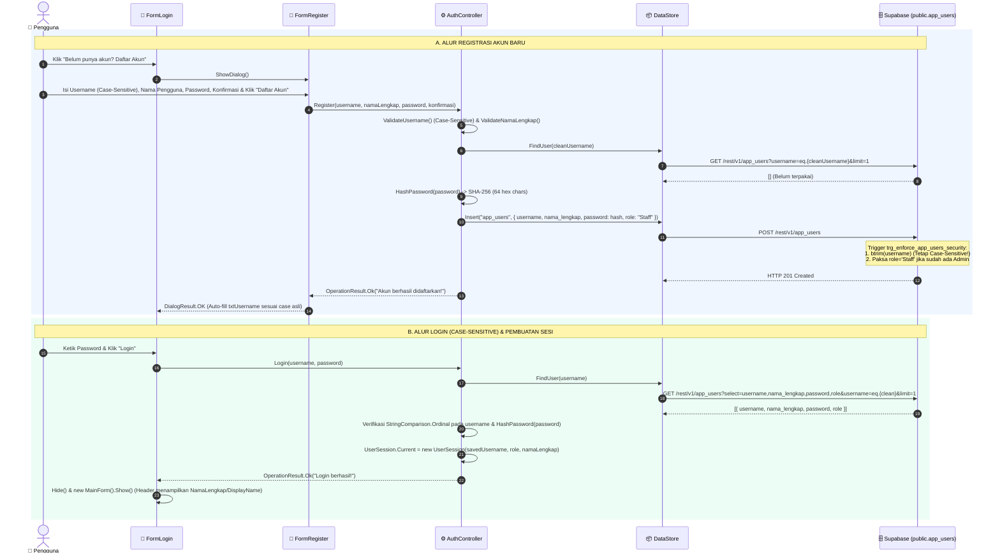
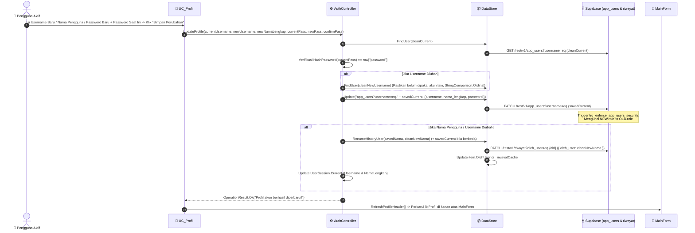

# 🔐 Alur Autentikasi, Registrasi, dan Sesi

⬅️ Kembali ke [[MOC - Panduan & Alur Bisnis]] | [[00 - Home]] | Lihat juga: [[AuthController]] · [[Tabel app_users]] · [[FormLogin & FormRegister]] · [[UC_Profil]]

> [!info] Kuadran Diátaxis: **Explanation & How-to**
> Dokumen ini membedah secara menyeluruh bagaimana proses **Login**, **Registrasi Akun Baru**, **Ubah Profil (Username/Password)**, dan **Logout** bekerja mulai dari antarmuka pengguna hingga ke *trigger* keamanan di PostgreSQL Supabase.

---

## 1. Diagram Urutan (*Sequence Diagram*): Login & Registrasi

---

## 2. Diagram Urutan: Ubah Profil (Username/Nama Pengguna/Password) & Sinkronisasi Riwayat

Ketika pengguna mengganti **Username**, **Nama Pengguna** (`nama_lengkap`), atau **Password** di halaman [[UC_Profil]], aplikasi memperbarui [[Tabel app_users]], menyinkronkan kolom `oleh_user` di [[Tabel riwayat]], dan memperbarui teks header di [[MainForm (Navigasi & RBAC UI)|MainForm]]:

