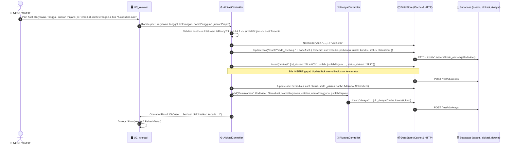
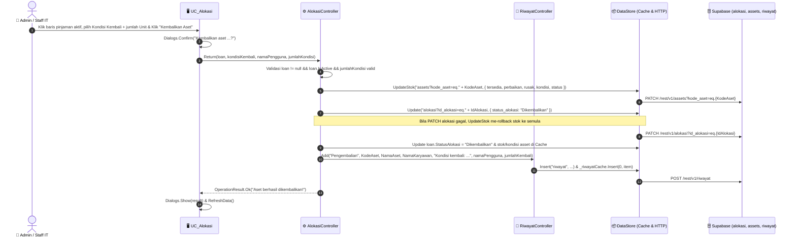

# 🤝 Alur Peminjaman (Alokasi) & Pengembalian Aset

⬅️ Kembali ke [[MOC - Panduan & Alur Bisnis]] | [[00 - Home]] | Lihat juga: [[AlokasiController]] · [[UC_Alokasi]] · [[Tabel alokasi]] · [[Tabel assets]] · [[Tabel riwayat]]

> [!info] Kuadran Diátaxis: **How-to Guide & Technical Workflow**
> Dokumen ini menjelaskan aturan bisnis, langkah operasional, dan urutan transaksi multi-tabel saat meminjamkan aset kepada karyawan (`Allocate`) maupun saat menerima pengembalian aset (`Return`).

---

## 1. Syarat & Aturan Bisnis Sirkulasi Aset

1. **Syarat Aset Dapat Dipinjam (`AssetItem.IsReadyToLend`) & Logika Stok Multi-Unit**:
   - Setiap aset memiliki kuota total unit (`Jumlah >= 1`), unit siap pinjam (`Tersedia >= 0`), serta pencacah unit bermasalah di gudang (`Perbaikan >= 0`, `Rusak >= 0`), dengan unit dipinjam `Dipinjam = Math.Max(0, Jumlah - Tersedia - Bermasalah)`.
   - Sebuah aset muncul di dropdown `cmbAset` pada [[UC_Alokasi]] (dengan tampilan `"AST-002 - MacBook Pro M4 14 Inch (Sisa: 1)"`) dan diizinkan untuk dipinjamkan apabila:
     $$\text{Tersedia} > 0 \quad \land \quad \text{Status} = \text{"Tersedia"} \quad \land \quad \text{Kondisi} \notin \{\text{"Perbaikan"}, \text{"Rusak"}\}$$
     *(Aset dengan kondisi campuran seperti `"Baik (2), Rusak (2)"` tetap memenuhi `IsReadyToLend` karena 2 unit yang baik masih tersedia untuk dipinjam!)*
   - **Contoh Skenario Dunia Nyata (Pinjam Satuan maupun Sekaligus)**:
     - Awalnya `Jumlah = 5`, `Tersedia = 5`, `Status = "Tersedia"`.
     - Ketika **3 unit dipinjam sekaligus** (`jumlahPinjam = 3`): `Tersedia` berkurang menjadi `2` (`Dipinjam = 3`). Karena masih tersisa `2` unit, `Status` tetap `"Tersedia"` dan aset tersebut **masih bisa dipinjam maksimal 2 unit lagi**.
     - Ketika **2 unit sisanya dipinjam**: `Tersedia` menjadi `0` (`Dipinjam = 5`). Karena stok sudah habis, `Status` otomatis berubah menjadi `"Dipinjam"` dan aset tidak lagi bisa dipinjamkan sampai ada unit yang dikembalikan!
     - Saat transaksi dengan `Jumlah = 3` dikembalikan berkondisi `Baik`, `Tersedia` langsung bertambah kembali sebesar `+3` unit.
     - Selama minimal 1 unit sedang dipinjam (`Dipinjam > 0`), aset tersebut diproteksi agar **tidak dapat dihapus** dan total `Jumlah`-nya **tidak dapat dikurangi** di bawah jumlah unit yang sedang dipinjam.
2. **Hak Akses Eksekusi**:
   - **Peminjaman / Alokasi Baru (`Allocate`)**: Dapat dilakukan oleh **Admin IT** maupun **Staff IT**.
   - **Pengembalian Aset (`Return`)**: Dapat dilakukan oleh **Admin IT** maupun **Staff IT**.
3. **Pembaruan Kondisi Dinamis Saat Kembali**:
   - Saat aset dikembalikan, petugas memilih kondisi fisik perangkat terkini (`"Baik"`, `"Perbaikan"`, atau `"Rusak"`).
   - Petugas juga mengisi **Unit** (jumlah unit yang berkondisi tersebut, `1..loan.Jumlah`). Contoh: dari total 3 unit yang seluruhnya sedang dipinjam, saat dikembalikan pilih `Rusak` dan Unit `1`; maka 2 unit sisanya otomatis kembali Baik (`Tersedia = 2`, `Rusak = 1`, `Kondisi = "Baik (2), Rusak (1)"`).

---

## 2. Diagram Urutan: Transaksi Peminjaman Aset (`AlokasiController.Allocate`)

---

## 3. Diagram Urutan: Transaksi Pengembalian Aset (`AlokasiController.Return`)

