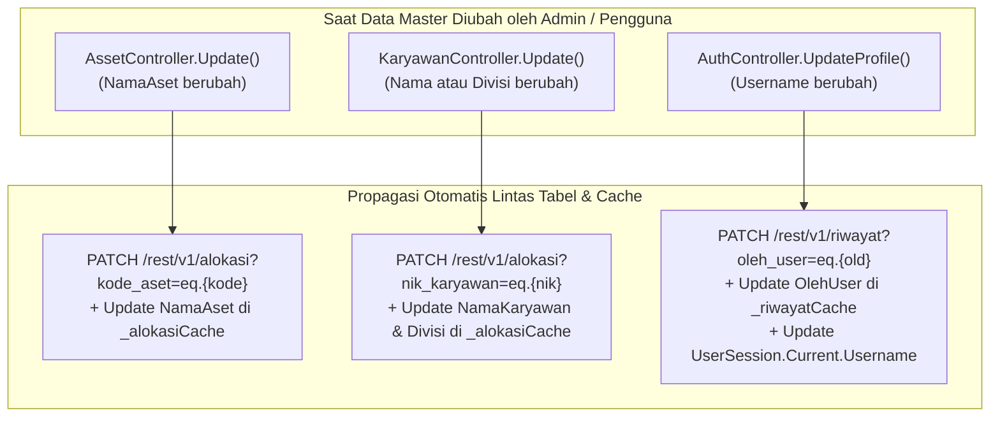

# ⚡ Alur Sinkronisasi Cache & Denormalisasi Data

⬅️ Kembali ke [[MOC - Panduan & Alur Bisnis]] | [[00 - Home]] | Lihat juga: [[DataStore.cs (REST Client & In-Memory Cache)]] · [[ADR-002 - Strategi In-Memory Caching pada DataStore]] · [[ADR-003 - Penggunaan Natural Primary Key dan Denormalisasi Terkendali pada Tabel Alokasi]]

> [!info] Kuadran Diátaxis: **Explanation** *(Understanding-Oriented)*
> Dokumen ini menjelaskan bagaimana aplikasi menjaga **konsistensi 100%** antara data di server PostgreSQL Supabase dan 4 koleksi cache di memori lokal (`_assetsCache`, `_karyawanCache`, `_alokasiCache`, `_riwayatCache`), termasuk propagasi perubahan pada kolom yang terdenormalisasi.

---

## 1. Peta Operasi Mutasi dan Efek Sinkronisasinya

Setiap kali terjadi operasi tulis di Controller, urutan eksekusi selalu mematuhi prinsip **Server-First, Memory-Second** (request ke Supabase harus berhasil terlebih dahulu sebelum objek di RAM diubah):

| Aksi Pengguna | Controller & Method | Tabel Supabase yang Diubah | Koleksi Cache Memori yang Disinkronkan |
| :--- | :--- | :--- | :--- |
| **Tambah Aset Baru** | `AssetController.Add` | 1. `POST /assets` 2. `POST /riwayat` | 1. `_assetsCache.Add(new AssetItem)` 2. `_riwayatCache.Insert(0, new RiwayatItem)` |
| **Ubah Data Aset** | `AssetController.Update` | 1. `PATCH /assets?kode_aset=eq.{kode}` *(termasuk `jumlah`, `tersedia`, `perbaikan`, `rusak`, `kondisi`, `status`)* 2. *(Jika nama berubah)* `PATCH /alokasi?kode_aset=eq.{kode}` | 1. Mutasi properti objek `AssetItem` (stok & kondisi parsial) di `_assetsCache` 2. Mutasi `alokasi.NamaAset` di `_alokasiCache` |
| **Hapus Aset** | `AssetController.Delete` | 1. `DELETE /assets?kode_aset=eq.{kode}` *(DB otomatis cascade delete ke `alokasi`)* 2. `POST /riwayat` (`"Hapus Aset"`) | 1. `_assetsCache.Remove(asset)` 2. `_alokasiCache.RemoveAll(a => a.KodeAset == kode)` 3. `_riwayatCache.Insert(0, new RiwayatItem)` |
| **Tambah Karyawan** | `KaryawanController.Add` | 1. `POST /karyawan` | 1. `_karyawanCache.Add(item)` |
| **Ubah Karyawan** | `KaryawanController.Update` | 1. `PATCH /karyawan?nik=eq.{nik}` 2. *(Jika nama/divisi berubah)* `PATCH /alokasi?nik_karyawan=eq.{nik}` | 1. Mutasi properti objek `KaryawanItem` di `_karyawanCache` 2. Mutasi `alokasi.NamaKaryawan` & `Divisi` di `_alokasiCache` |
| **Hapus Karyawan** | `KaryawanController.Delete` | 1. `DELETE /karyawan?nik=eq.{nik}` *(DB otomatis cascade delete ke `alokasi`)* | 1. `_karyawanCache.Remove(karyawan)` 2. `_alokasiCache.RemoveAll(a => a.NikKaryawan == nik)` |
| **Pinjamkan Aset** | `AlokasiController.Allocate` | 1. `PATCH /assets?kode_aset=eq.{kode}` 2. `POST /alokasi` 3. `POST /riwayat` | 1. `asset.Tersedia` & `asset.Status` di `_assetsCache` 2. `_alokasiCache.Add(new AlokasiItem)` 3. `_riwayatCache.Insert(0, new RiwayatItem)` |
| **Kembalikan Aset** | `AlokasiController.Return` | 1. `PATCH /assets?kode_aset=eq.{kode}` 2. `PATCH /alokasi?id_alokasi=eq.{id}` *(gagal: stok di-rollback)* 3. `POST /riwayat` | 1. `loan.StatusAlokasi = "Dikembalikan"` di `_alokasiCache` 2. `asset.Tersedia/Perbaikan/Rusak/Kondisi/Status` di `_assetsCache` 3. `_riwayatCache.Insert(0, new RiwayatItem)` |
| **Bersihkan Riwayat** | `RiwayatController.ClearAll` | 1. `DELETE /riwayat?waktu=not.is.null` | 1. `_riwayatCache.Clear()` |
| **Ubah Profil Akun** | `AuthController.UpdateProfile` | 1. `PATCH /app_users?username=eq.{old}` *(`username`, `nama_lengkap`, `password`)* 2. `PATCH /riwayat?oleh_user=eq.{old}` *(via `RenameHistoryUser`)* | 1. Mutasi `item.OlehUser = newDisplayName` di `_riwayatCache` 2. Mutasi `UserSession.Current` (`Username` & `NamaLengkap`) |
| **Pindah Halaman** | `MainForm.ShowPage` | *(Jika umur cache $\ge$ 60 detik)* `GET` ulang tabel halaman tujuan | `DataStore.ClearExpiredCache()` sebelum halaman dibuat; tetap pakai cache RAM bila masih `< 60 detik` |
| **Logout** | `MainForm.btnLogout_Click` | - | `DataStore.ClearCache()` (keempat cache diatur ke `null`) |

---

## 2. Diagram Propagasi Sinkronisasi Denormalisasi

