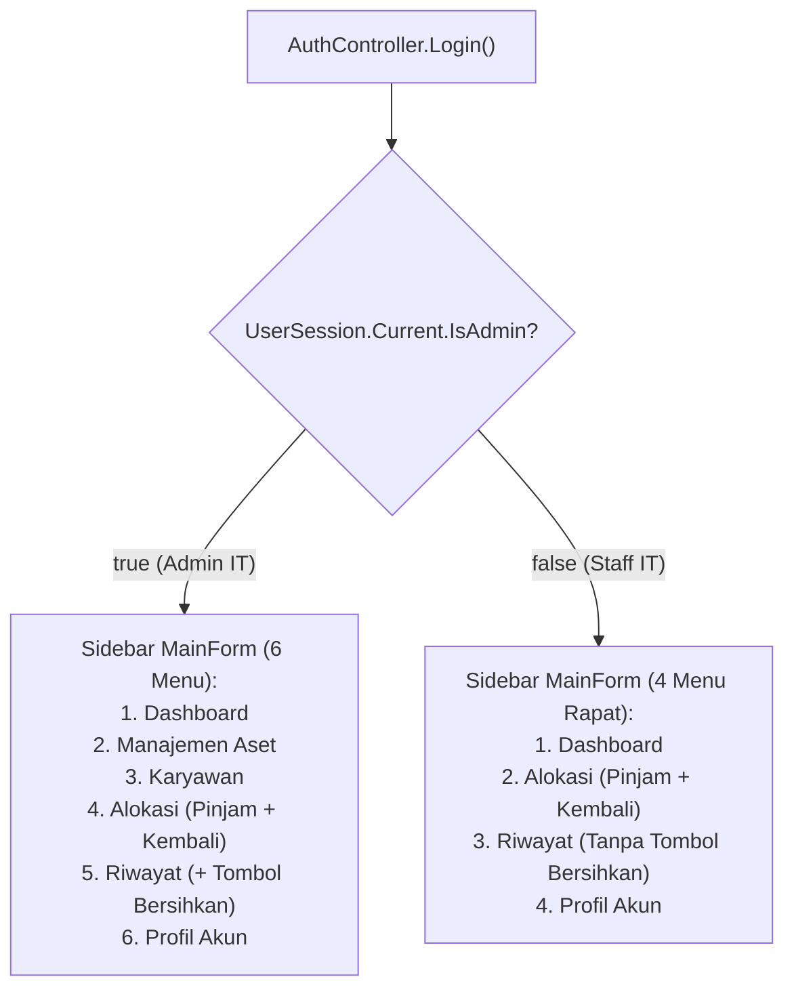

# 🛡️ Matriks Hak Akses (RBAC Admin vs Staff)

⬅️ Kembali ke [[MOC - Panduan & Alur Bisnis]] | [[00 - Home]] | Lihat juga: [[UserSession & OperationResult]] · [[MainForm (Navigasi & RBAC UI)]] · [[Keamanan RLS, Trigger, dan Fungsi Database]]

> [!info] Gambaran Umum Kontrol Akses Berbasis Peran (RBAC)
> Sistem **IT Asset Management** membagi pengguna ke dalam 2 peran (`UserRole`):
> - **Admin IT (`UserRole.Admin`)**: Pengelola penuh inventaris master aset, data karyawan, alokasi peminjaman, pengembalian, dan pemeliharaan log riwayat.
> - **Staff IT (`UserRole.Staff`)**: Petugas operasional yang dapat memantau dashboard, melakukan peminjaman (alokasi) maupun pengembalian aset karyawan, melihat/mencari log riwayat, dan mengelola profil akunnya sendiri.

---

## 1. Tabel Perbandingan Hak Akses Fitur & Menu

| Modul / Fitur | Admin IT (`Admin`) | Staff IT (`Staff`) | Lokasi Penegakan Aturan di Kode & Database |
| :--- | :---: | :---: | :--- |
| **Login & Logout** | ✅ Ya | ✅ Ya | [[FormLogin & FormRegister\|FormLogin]], [[AuthController]] |
| **Registrasi Akun Baru** | Otomatis jadi `Admin` hanya jika tabel `app_users` masih kosong (0 Admin) | ✅ Pendaftaran baru otomatis menjadi `Staff` | `AuthController.Register` ([L99-L135](file:///d:/AMIKOM/Pemrograman%20Lanjut/Project/ITAssetManagement/ITAssetManagement/Controllers/AuthController.cs#L99-L135)) + Trigger PostgreSQL `enforce_app_users_security()` |
| **Menu Dashboard** ([[UC_Dashboard]]) | ✅ Penuh | ✅ Penuh | `MainForm.ArrangeMenus` ([L41-L56](file:///d:/AMIKOM/Pemrograman%20Lanjut/Project/ITAssetManagement/ITAssetManagement/Views/MainForm.cs#L41-L56)) |
| **Menu Manajemen Aset** ([[UC_Asset]]) | ✅ Penuh (Tambah, Ubah, Kelola Kondisi Sebagian `Perbaikan`/`Rusak`, Hapus tercatat di Riwayat, Cari) | ❌ Disembunyikan dari Sidebar | `MainForm.ArrangeMenus` (`menu != btnAsset`) |
| **Menu Karyawan** ([[UC_Karyawan]]) | ✅ Penuh (Tambah, Ubah, Hapus, Cari) | ❌ Disembunyikan dari Sidebar | `MainForm.ArrangeMenus` (`menu != btnKaryawan`) |
| **Menu Alokasi — Form Peminjaman Baru** (`grpPinjam` di [[UC_Alokasi]]) | ✅ Dapat meminjamkan aset ke karyawan (termasuk multi-unit sekaligus) | ✅ Dapat meminjamkan aset ke karyawan (termasuk multi-unit sekaligus) | `UC_Alokasi.OnLoad` ([L28-L35](file:///d:/AMIKOM/Pemrograman%20Lanjut/Project/ITAssetManagement/ITAssetManagement/Views/UC_Alokasi.cs#L28-L35)) & `btnAlokasi_Click` ([L111-L125](file:///d:/AMIKOM/Pemrograman%20Lanjut/Project/ITAssetManagement/ITAssetManagement/Views/UC_Alokasi.cs#L111-L125)) |
| **Menu Alokasi — Pengembalian Aset** (`pnlDaftar` di [[UC_Alokasi]]) | ✅ Dapat memproses pengembalian aset (kondisi utuh maupun sebagian) | ✅ Dapat memproses pengembalian aset (kondisi utuh maupun sebagian) | `UC_Alokasi.OnLoad` ([L28-L35](file:///d:/AMIKOM/Pemrograman%20Lanjut/Project/ITAssetManagement/ITAssetManagement/Views/UC_Alokasi.cs#L28-L35)) & `btnKembalikan_Click` ([L128-L153](file:///d:/AMIKOM/Pemrograman%20Lanjut/Project/ITAssetManagement/ITAssetManagement/Views/UC_Alokasi.cs#L128-L153)) |
| **Menu Riwayat — Lihat, Filter & Cari** ([[UC_Riwayat]]) | ✅ Penuh | ✅ Penuh | `UC_Riwayat.OnLoad` ([L20-L34](file:///d:/AMIKOM/Pemrograman%20Lanjut/Project/ITAssetManagement/ITAssetManagement/Views/UC_Riwayat.cs#L20-L34)) |
| **Menu Riwayat — Bersihkan Seluruh Riwayat** (`btnBersihkan` di [[UC_Riwayat]]) | ✅ Tombol tampil & diizinkan oleh Controller | ❌ Tombol disembunyikan & ditolak oleh Controller | UI: `UC_Riwayat.OnLoad` (`btnBersihkan.Visible = isAdmin;` — [L26](file:///d:/AMIKOM/Pemrograman%20Lanjut/Project/ITAssetManagement/ITAssetManagement/Views/UC_Riwayat.cs#L26)) Controller: `RiwayatController.ClearAll(isAdmin)` ([L68-L86](file:///d:/AMIKOM/Pemrograman%20Lanjut/Project/ITAssetManagement/ITAssetManagement/Controllers/RiwayatController.cs#L68-L86)) |
| **Menu Profil Akun** ([[UC_Profil]]) | ✅ Ubah Username, Nama Pengguna & Password sendiri | ✅ Ubah Username, Nama Pengguna & Password sendiri | `UC_Profil` + Trigger `enforce_app_users_security()` (mengunci `NEW.role := OLD.role`) |

---

## 2. Diagram Adaptasi Antarmuka Berdasarkan Peran (`Role-Adaptive UI`)

